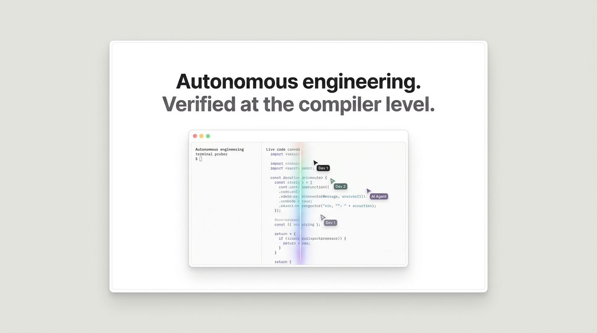

<div align="center">

# Swiss Neutral — Vektor Studio

**Quiet grotesk precision with one loud accent. Engineered for autonomous software development and terminal workflows.**

[](https://opensource.org/licenses/Apache-2.0)
[](https://react.dev/)
[](https://www.typescriptlang.org/)
[](https://tailwindcss.com/)
[](https://github.com/bymilon)
[](https://x.com/milonspace)
[](CONTRIBUTING.md)

[Live Demo](https://github.com/bymilon/swiss-neutral-vektor-studio) · [Report Bug](https://github.com/bymilon/swiss-neutral-vektor-studio/issues) · [Request Feature](https://github.com/bymilon/swiss-neutral-vektor-studio/issues)

<br />



</div>

---

## Overview

**Swiss Neutral** is a production-grade, highly restrained landing page and design system built for developer tools, autonomous coding runtimes, and engineering platforms. 

Distilled from real redesign iterations, it rejects generic "AI slop" aesthetics—no purple-gradient-on-white clichés, no floating amorphous drop shadows, and no unboxed pill badge clutter. Instead, it pairs near-black **Inter Tight** typography with mid-sentence drops to pale gray, hairline structural dividers, a warm-gray outer page (`#e9e9e6`) housing a single white shell (`#ffffff`), and a single iridescent brand gradient (`#ff5bd6 → #8b5cf6 → #38bdf8`) saved exclusively for moments that matter.

---

## Key Highlights

- **🖥️ Living App-Window Mockup**: Embedded application canvas featuring a 34px pastel title bar, live workspace status, active multi-artboard canvas, drifting actor cursors (`Codex` and `Alex (Tech Lead)`), and a docked 220px task pipeline.
- **✨ Signature Reveal Sweep**: Continuous, pure CSS animation simulating real-time autonomous generation—a 2px glowing iridescent gradient line wiping down the streaming frame (`top: 57% → 101%` over 7 seconds) with sequential skeleton line builds and blinking caret.
- **🎛️ Interactive Controls**: Real-time canvas zoom selector (`90%`, `100%`, `110%`), sweep play/pause toggle, interactive sandbox provisioning modal, and one-click terminal simulation.
- **📐 Mathematical Rails Architecture**: Faint vertical hairlines (`1px solid #f0f0ec`) inset 44px from the shell edges running the entire page height.
- **🖋️ Strict Typographic Hierarchy**: Inter Tight with tight `-0.045em` tracking for headlines, paired with IBM Plex Mono reserved exclusively for page-level microlabels (never inside product UI mockups).
- **📜 Refined Scrollbar Aesthetics**: Custom 7px whisper-thin scrollbars styled to blend seamlessly with the warm-gray canvas and dark terminal viewports.

---

## Design System Tokens

| Token | Value | Role in Vektor Studio |
|---|---|---|
| `page` | `#e9e9e6` | Outer canvas surround |
| `card / shell` | `#ffffff` | Single 18px-radius white container & cards |
| `line-1` | `#f0f0ec` | 44px inner rails, section dividers |
| `line-2` | `#e3e3df` / `#e6e6e2` | Card outlines, window hairline borders |
| `ink` | `#161614` | Headlines, primary action pills, dark UI |
| `body` | `#71716b` | Technical body copy (13–14px / 1.65 line-height) |
| `headline-gray` | `#b9b9b2` | De-emphasized second line / trailing headline clause |
| `brand gradient` | `#ff5bd6 → #8b5cf6 → #38bdf8` | Reveal line, logo glyph, testimonial highlight |
| `accent-warm` | `#d97757` | Agent presence (Codex cursor, active task badges) |
| `accent-state` | `#8b5cf6` | Active streaming state, border highlights (`#a78bfa`) |
| `positive` | `#16a34a` / `#22c55e` | Live execution status, verified compiler passes |

---

## Page Anatomy

```
┌──────────────────────────────────────────────────────────────────┐  #e9e9e6 Page Background
│  ┌────────────────────────────────────────────────────────────┐  │  20px Margin, 18px Radius
│  │ 44px Rail │                                    │ 44px Rail │  │  #ffffff Shell (#e3e3df border)
│  │     │     ├────────────────────────────────────┤     │     │  │
│  │     │     │ 1. Navigation (Top Bar Contract)   │     │     │  │
│  │     │     ├────────────────────────────────────┤     │     │  │
│  │     │     │ 2. Hero Section                    │     │     │  │
│  │     │     │    - Two-Tone Headline & CTAs      │     │     │  │
│  │     │     │    - Living App-Window Mockup      │     │     │  │
│  │     │     │    - Equal-cell Hairline Logo Bar  │     │     │  │
│  │     │     ├────────────────────────────────────┤     │     │  │
│  │     │     │ 3. Workflow Steps (01, 02, 03)     │     │     │  │
│  │     │     ├────────────────────────────────────┤     │     │  │
│  │     │     │ 4. Centered "One Command" Moment   │     │     │  │
│  │     │     ├────────────────────────────────────┤     │     │  │
│  │     │     │ 5. Attributable Testimonial Quote  │     │     │  │
│  │     │     ├────────────────────────────────────┤     │     │  │
│  │     │     │ 6. Capabilities Bento Grid         │     │     │  │
│  │     │     ├────────────────────────────────────┤     │     │  │
│  │     │     │ 7. Technical Accordion FAQ         │     │     │  │
│  │     │     ├────────────────────────────────────┤     │     │  │
│  │     │     │ 8. Closing CTA (Subtle Brand Glow) │     │     │  │
│  │     │     ├────────────────────────────────────┤     │     │  │
│  │     │     │ 9. Engineered Footer & Microlabels │     │     │  │
│  │     │     └────────────────────────────────────┘     │     │  │
│  └────────────────────────────────────────────────────────────┘  │
└──────────────────────────────────────────────────────────────────┘
```

---

## Quick Start

### Prerequisites

- **Node.js**: v18.0.0 or higher
- **npm**: v9.0.0 or higher

### Installation

Clone the repository and install dependencies:

```bash
git clone https://github.com/bymilon/swiss-neutral-vektor-studio.git
cd swiss-neutral-vektor-studio
npm install
```

### Development Server

Start Vite development server on port 3000:

```bash
npm run dev
```

Open [http://localhost:3000](http://localhost:3000) in your browser.

### Type Checking & Linting

Validate strict TypeScript typing and syntax integrity:

```bash
npm run lint
```

### Production Build

Create an optimized static distribution:

```bash
npm run build
```

---

## Project Structure

```
├── .github/
│   └── pull_request_template.md    # PR template with code ownership checklist
├── index.html                      # HTML5 entry with Inter Tight font preloads
├── package.json                    # Scripts and dependencies
├── src/
│   ├── assets/
│   │   └── images/                 # High-resolution UI preview screenshots
│   ├── App.tsx                     # Root page layout, shell & 44px inner rails
│   ├── index.css                   # Tailwind v4 theme, keyframes & scrollbar
│   ├── main.tsx                    # React DOM entry point
│   └── components/
│       ├── Navigation.tsx          # 3-Zone top bar contract with GitHub link
│       ├── Hero.tsx                # Two-tone headline, living demo & logo bar
│       ├── AppWindowMockup.tsx     # Living app mockup, sweep & drifting cursors
│       ├── WorkflowSection.tsx     # Editorial 01-03 steps with code prober
│       ├── CommandSection.tsx      # Interactive terminal & execution simulator
│       ├── TestimonialSection.tsx  # Attributable quote & gradient highlight
│       ├── CapabilitiesGrid.tsx    # Asymmetric Bento grid with real metrics
│       ├── FaqSection.tsx          # Interactive zero-jump accordion
│       ├── ClosingCta.tsx          # Final conversion block with blurred glow
│       ├── Footer.tsx              # IBM Plex Mono microlabels & status indicators
│       └── SandboxModal.tsx        # Interactive Firecracker microVM launcher
├── tsconfig.json                   # Strict TypeScript compiler configuration
├── CONTRIBUTING.md                 # Contributor code ethics & review standards
├── LICENSE                         # Apache-2.0 License
└── README.md                       # Repository documentation
```

---

## Open Source Ethics & Contributor Spirit

This project adheres to collaborative open-source principles:

1. **Take Responsibility for Your Code**: If you utilize AI assistants or code generators, you must personally review, understand, and take full responsibility for every line before opening a PR. Do not submit unreviewed automated dumps.
2. **Communicate Clearly ("Say Human")**: Keep issue discussions, pull request titles, and review comments concise, factual, and direct. Avoid boilerplate padding.
3. **Verify Before Submitting**: Always verify type safety (`npm run lint`), build integrity (`npm run build`), and responsive behavior across screen sizes.

For detailed guidelines, see [CONTRIBUTING.md](./CONTRIBUTING.md).

---

## Author & Connect

Maintained and created by **Milon Biswas**:

- **GitHub**: [@bymilon](https://github.com/bymilon)
- **X (formerly Twitter)**: [@milonspace](https://x.com/milonspace)
- **Repository**: [https://github.com/bymilon/swiss-neutral-vektor-studio](https://github.com/bymilon/swiss-neutral-vektor-studio)

---

## License

Distributed under the **Apache-2.0 License**. See [LICENSE](./LICENSE) for more information.

---

<div align="center">
Built with precision · Inter Tight 600 / -.045em · by <a href="https://github.com/bymilon">@bymilon</a>
</div>
